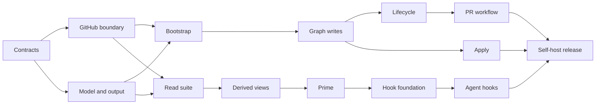

# Qew v1 plan

## Goal

Deliver a greenfield, Hew-shaped GitHub Issues work graph with safe agent
context, dependency-aware execution, plan application, PR lifecycle, campaigns,
Projects visibility, and session hooks. Beads migration is out of scope.

The existing `ready` command is an early slice; it is not the completed v1
contract.

[`qew-v1.jsonl`](qew-v1.jsonl) is the machine-applicable plan. It includes the
work discovered while executing this design: bootstrap lifecycle, campaign and
Project application, agent-hook children, distribution, release provenance,
and the complete command synopsis.

## Delivery rules

- One work-package issue and one PR per independently landing slice.
- Every behavior change starts with a failing command-level golden or seam walk.
- Native parent and blocked-by relationships are graph truth.
- Newly discovered work becomes an issue with provenance and may block any work
  package across plan boundaries.
- Unapproved issue content never enters routine agent context.

## Work packages

| ID | Outcome | Blocked by |
|---|---|---|
| `contracts` | Freeze vocabulary, JSON/NDJSON schemas, exits, and threat model. | — |
| `github-boundary` | Repository discovery, complete pagination, strict decoding, and least-authority `gh` calls. | `contracts` |
| `model-output` | Priority/type normalization, graph invariants, compact rendering, and Unicode findings. | `contracts` |
| `bootstrap` | `init` creates the closed label vocabulary and prints agent guidance idempotently. | `github-boundary`, `model-output` |
| `read-suite` | `list`, `show`, `search`, `triage`, `blocked`, and `graph check`. | `github-boundary`, `model-output` |
| `graph-writes` | `create`, `set`, parent/discovery links, and cycle-checked `block`/`unblock`. | `bootstrap`, `read-suite` |
| `derived-views` | Finish `ready`; add plan/epic rollups and deterministic next work. | `read-suite` |
| `lifecycle` | Guarded `start`, `complete`, `close`, and `reopen`, including claim re-read. | `graph-writes`, `derived-views` |
| `campaign-projects` | Milestones plus an idempotent GitHub Projects visibility surface. | `bootstrap`, `read-suite` |
| `apply` | JSONL validation, dry-run, parent/dependency/campaign creation, checkpoints, and safe resume. | `graph-writes`, `campaign-projects` |
| `pr-workflow` | Linked draft/ready PR creation with branch and closing-reference guarantees. | `lifecycle` |
| `prime-hooks` | Nested plan that closes when all prime and agent-hook children close. | `derived-views` |
| `prime` | Bounded vetted conventions, ready work, active work, blockers, and contradictions. | `derived-views` |
| `hook-foundation` | Shared atomic, idempotent configuration editing with symlink refusal. | `prime` |
| `hook-claude` | Claude Code SessionStart installation and removal. | `hook-foundation` |
| `hook-codex` | Codex project-hook installation, removal, and trust guidance. | `hook-foundation` |
| `hook-opencode` | Auto-discovered opencode plugin installation and removal. | `hook-foundation` |
| `hook-cursor` | Cursor sessionStart installation with `additional_context` JSON output. | `hook-foundation` |
| `self-host-release` | Build Qew through its own queue, package it, document installation, and run end-to-end golden and refusal walks. | `apply`, `pr-workflow`, `prime-hooks` |

## Completion

- The installed `qew apply` validates the complete JSONL plan, which has unique
  work identifiers; checkpointed resume verifies created work instead of
  creating it twice.
- `qew ready` always explains or refuses incomplete graph state.
- A fresh agent receives bounded vetted context from `qew prime`.
- GitHub shows campaign, plan, WP, dependency, PR, and progress state without a
  second database.
