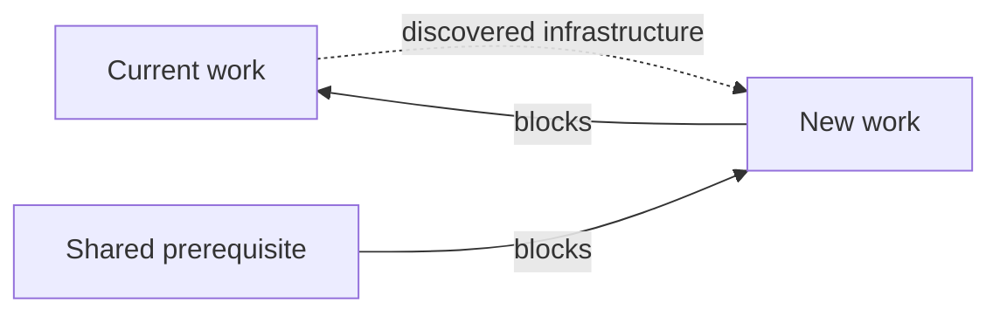

# Work graph

## GitHub mapping

- Campaign: milestone.
- Plan: parent issue assigned to a campaign.
- Work package: sub-issue with one pull request when implemented.
- Execution edge: GitHub `blocked by`; blocker must close before dependent work
  is ready.
- Discovery edge: provenance recorded by Qew; it does not gate execution.

Plans may share blockers. A work package discovered during another package may
belong to a different plan.

## Invariants

- Repository policy is explicit in `.qew/config.json`. Overlay mode scopes the
  graph to `qew:managed`; repository mode treats every issue as intake. The
  optional `project` field links the checkout to its Qew Project by number, which
  survives renaming the board. Unknown fields
  are ignored so an additive field never breaks a newer Qew, and `init` keeps
  fields it does not own. An optional `minimum_version` (`MAJOR.MINOR.PATCH`)
  makes an older Qew refuse with the required version and the upgrade command;
  without it nothing is checked. An optional `max_active_claims` (positive
  integer) makes `start` refuse (exit 6) before any write, including priority
  triage, when the calling login already holds that many open `in-progress`
  issues in the repository; colleagues' claims are not counted because the
  config is shared. A malformed value is invalid configuration (exit 2).
  `mode` and `schema_version` stay strict.
- `qew:managed` is membership and `qew:approved` is trust. Neither implies the
  other.
- The execution graph is a DAG. Reject an edge that creates a cycle.
- Hierarchy does not imply execution order.
- A work package is ready only when it is open, approved, unclaimed, every
  blocker is closed, and it does not carry `needs:approval`. That label marks a
  gate a human must authorize before the work may start; it is derived state
  `needs_approval`, never ready. Work Qew creates carries it by default.
- An issue carrying `qew:draft` is a draft: derived state `draft`, never ready,
  startable, completable or listed by routine reads, even when `qew:approved`
  is also present. See `drafts.md`.
- Every item Qew creates names the human who asked for it under
  `## Requested by`; the quote records who wanted the work, `needs:approval`
  records whether it may start.
- Unknown or truncated dependency data makes readiness indeterminate and must
  fail closed.
- Closing a blocker may make all of its open dependents ready.
- Project fields and boards are views; issue relationships are graph truth.

## Closed vocabulary

- Priority is exactly one of `P0`, `P1`, `P2`, `P3`, or `P4`.
- Work type is exactly one of `bug`, `enhancement`, or `task`.
- The normalizer selects the highest priority and fixed type order for bounded
  diagnostics, but work with missing or contradictory vocabulary is not ready.
- GitHub label names are case-insensitive for ASCII only; Qew folds ASCII case
  and never Unicode-casefolds, so look-alikes such as the Kelvin sign are
  distinct labels. Qew decodes closed vocabulary to its
  canonical spelling before applying these rules.
- An `epic` is a parent plan and is never ready work.
- Ready JSON schema `3` carries canonical `priority` and `type` values, total
  and truncation metadata, and sorts P0 through P4, then by issue number.

## Diagnostics

`qew graph check` reports native dependency cycles, multiple priority/type
labels, and an `in-progress` epic. It scans approved titles for zero-width
characters, bidirectional controls, Unicode tag characters, and high-signal
ASCII confusables. Findings are review hints; cycles and vocabulary
contradictions make the graph invalid. Cycle search (here and in `apply`) is an
iterative depth-first search with visited state: linear time, no recursion
limit, so diamonds and deep chains cannot hang or crash it.

When missing infrastructure is found, create the new work package, attach a
discovery edge, then add an execution edge only if it truly blocks progress.
